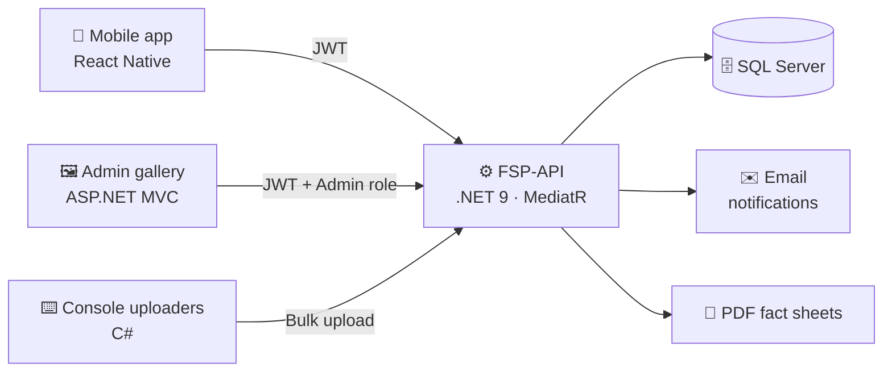

<div align="center">


<a href="https://github.com/MizunoAC">
  
</a>

<br/>


</div>

---

## 👨‍💻 About me

```csharp
var ulises = new Developer
{
    Role         = "C# Backend Developer",
    Focus        = new[] { "Payment systems", "Notification services", "RESTful APIs" },
    Architecture = new[] { "Clean Architecture", "CQRS", "Microservices" },
    Database     = "SQL Server (EF Core + ADO.NET + stored procedures)",
    Currently    = "Building a wildlife-tracking platform end to end 🌿",
    Learning     = "React Native + Expo",
    Philosophy   = "Make it work, make it secure, make it maintainable."
};
```

---

## 🛠️ Tech arsenal

<div align="center">


</div>

| 🧩 Area | 🔧 What I use |
|---|---|
| **Backend** | ASP.NET Core Web API & MVC · MediatR (CQRS) · Clean Architecture · Dependency Injection · NLog |
| **APIs** | RESTful design · DTOs · Request validation · Optional parameter handling · Structured error responses |
| **Data** | SQL Server · Entity Framework Core · ADO.NET · Stored procedures · Query optimization (`EXISTS` over subqueries) |
| **Payments** | Stripe · Google Pay · Secure token handling · Server-side payment flow |
| **Security** | JWT RS256 (access + refresh) · Role-based auth · BCrypt · Public/private key signing |
| **Integrations** | Twilio SMS · SendGrid & SMTP · RazorEngine templates · PuppeteerSharp (PDF) |
| **Workflow** | Git branching strategies · Conflict resolution · Remote sync · Docker · CI with GitHub Actions |
| **Mobile** | React Native · Expo Router · Ionic |

---

## 🌿 Featured project: FSP

> A wildlife sighting platform: users report animals with a photo and location, admins review and approve every record, and the community gets a species catalog with maps and PDF fact sheets.



<table>
  <tr>
    <td width="50%" valign="top">

### ⚙️ [FSP-API](https://github.com/MizunoAC/FSP-API)
REST API with **CQRS**, **JWT RS256** auth, an admin moderation flow, species catalog, sighting maps and PDF generation. Dockerized, with CI on GitHub Actions and 64+ commits of history.

`.NET 9` `MediatR` `SQL Server` `Docker` `Swagger`

    </td>
    <td width="50%" valign="top">

### 🖼️ [FSP-ImagenVisualizer](https://github.com/MizunoAC/FSP-ImagenVisualizer)
Admin-only image gallery built to browse hundreds of sighting photos.

- ✅ JWT login with token validation against the backend's public key
- ✅ Session handling and admin-only access
- ✅ Friendly image names (`fototrampaN`) instead of raw IDs
- ✅ Built-in view-only image viewer
- ✅ Branded green theme
- 🔜 Image listing served directly by the main API

`ASP.NET Core MVC` `.NET 8` `JWT`

    </td>
  </tr>
  <tr>
    <td width="50%" valign="top">

### 📱 fsp-mobile *(in progress)*
Mobile client for reporting sightings, built from scratch with a nature-inspired green UI.

- ✅ Expo + Expo Router project setup (`src/app`, `src/components`)
- 🚧 Screen layouts and design
- 🔜 Integration with the C# API

`React Native` `Expo` `TypeScript`

    </td>
    <td width="50%" valign="top">

### 🧪 [proyectoFIonic](https://github.com/MizunoAC/proyectoFIonic)
First mobile prototype of the platform.

`Ionic` `TypeScript`

    </td>
  </tr>
</table>

Supporting tools: C# console apps that bulk-upload images to the API.

---

## 💼 What I do professionally

<details open>
<summary><b>💳 Payment systems</b></summary>
<br/>

- Integrated payment gateways (**Stripe** and **Google Pay**) with secure token management and a complete server-side payment flow
- Designed and maintained payment APIs, documented with XML comments for Swagger
- Hardened stored procedures to avoid subquery errors and improve performance

</details>

<details>
<summary><b>🏗️ Architecture & modernization</b></summary>
<br/>

- Migrated legacy projects to **microservices** using **CQRS** and SQL Server, improving scalability and modularity
- Built and maintained applications with **.NET C#**, **Entity Framework Core** and SQL Server, following clean architecture and maintainability best practices

</details>

<details>
<summary><b>🔌 API design</b></summary>
<br/>

- Designed, implemented and consumed **RESTful APIs**
- DTOs, request validation, optional parameter handling and structured error management

</details>

<details>
<summary><b>🔔 Notification services</b></summary>
<br/>

- Multi-channel delivery (SMS via Twilio, email via SendGrid) driven by user preferences
- Phone number validation with libphonenumber
- Clean service architecture using dependency injection

</details>

<details>
<summary><b>📧 Dynamic email templates</b></summary>
<br/>

- Invoice emails that adapt to variable amounts of data using RazorEngine
- Inline embedded images, so emails render without stray attachments

</details>

<details>
<summary><b>🔀 Team workflow</b></summary>
<br/>

- Git version control: branching, conflict resolution and remote synchronization

</details>

---

## 📊 GitHub stats

<div align="center">


</div>

---

## 🤝 Let's connect

<div align="center">

[](https://github.com/MizunoAC)

*Open to feedback, collaboration and good coffee. ☕*


</div>